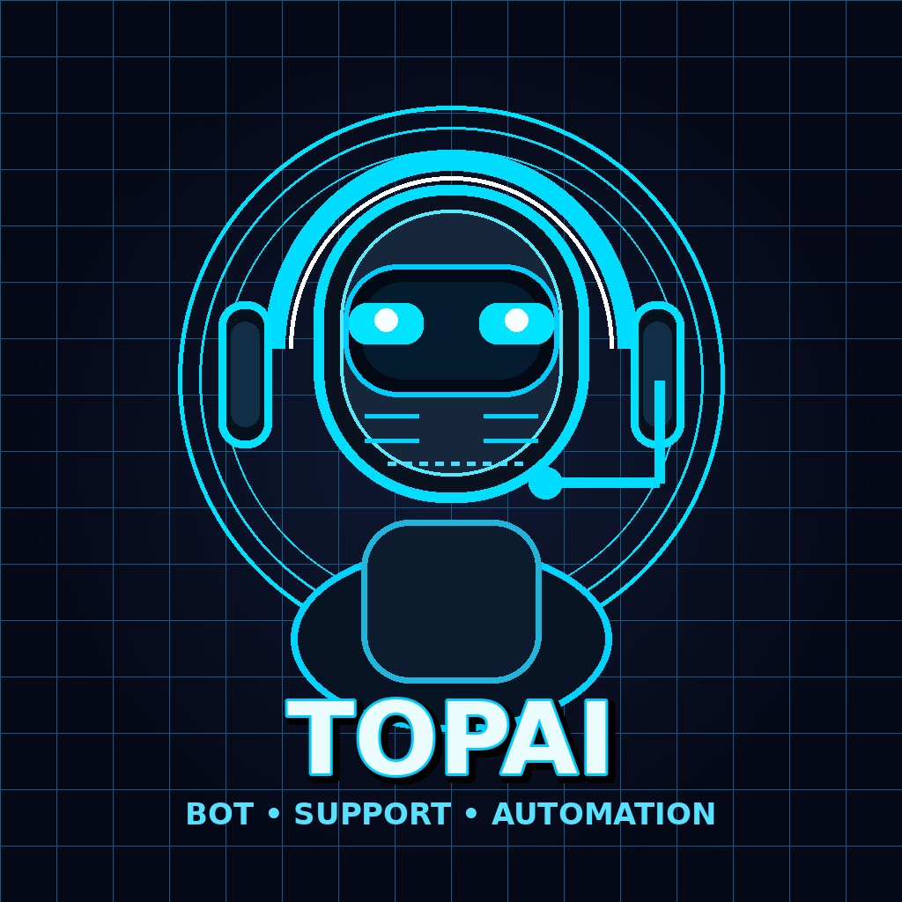

# 🤖 Topai Bot

Topai is a WhatsApp bot built with Baileys for group management, automation, media commands, view-once handling, plugin controls, and session management. The project includes a responsive admin control center and support for WhatsApp QR or pairing-code login.

### Recent Features
- ✅ `.vv` view-once image, video, and audio support
- ✅ `.vv set dm` or `.vv set normal` delivery modes
- ✅ Connected-account DM confirmation
- ✅ `.ping` status command branded as Topai
- ✅ `.mode public/private` command responses with the official Topai channel
- ✅ Reconnect handling and connection debug diagnostics
- ✅ Modern admin dashboard with Docker environment management

### Official Channel
Join [Topai on WhatsApp](https://whatsapp.com/channel/0029vb8viwd7oqhwdslne71s).

<div align="center">
  <a href="https://git.io/typing-svg">
    
  </a>
</div>

<div align="center">
  <a href="https://whatsapp.com/channel/0029vb8viwd7oqhwdslne71s">
    
  </a>
</div>

<div align="center">
  
  
  
  
</div>

---
<div>
  <a href="https://www.rapidproxy.io/?ref=Topai" target="_blank">
    
  </a>
</div>

<br>

<div align="left">
  <a href="https://www.rapidproxy.io/?ref=Topai" target="_blank"><b>RapidProxy</b></a> delivers fast, reliable proxy infrastructure for large-scale data operations. With high concurrency, non-expiring traffic, and AI-powered CAPTCHA bypass, it ensures efficient, uninterrupted data collection—trusted by developers worldwide.<br><br>
  90M+ Residential IPs • Smart Rotation • High Success Rate • Built for Scale<br><br>
  <b>Special Offer:</b> <a href="https://www.rapidproxy.io/?ref=Topai" target="_blank">Try it free</a> — Pricing from $0.65/GB with non-expiring traffic. Use code <b>RAPID10</b> for 10% off.
</div>

<br>

<div align="left">
  <a href="https://www.rapidproxy.io/?ref=Topai" target="_blank">
    
  </a>
</div>


## 🚀 Steps to Deploy Bot

### Step 1: Fork the Repository

Click the button below to fork the Topai Bot repository to your GitHub account:

<div align="center">
  <a href="https://github.com/Nicetv1165/Topai-MD/fork">
    
  </a>
</div>

---

### Step 2: Get Pair Code

Deploy the bot and easily connect it to your WhatsApp account by pair code. Click the button below to deploy the bot on Replit.

<div align="center">
  <a href="https://topai-bot-paircode.onrender.com" target="_blank">
    
  </a>
</div>


### After getting creds.json file, upload it to session folder

---

### Step 3: Deploy Now

For further customization and setup guidance, click the button below:

<div align="center">
  <a href="https://youtu.be/-oz_u1iMgf8">
    
  </a>
  <a href="https://bot-hosting.net/?aff=1068419752923508776">
    
  </a>
  <a href="https://render.com/deploy?repo=https://github.com/Nicetv1165/Topai-MD">
    
  </a>
</div>

### Deploy on VPS

<div align="center">
  <a href="https://client.petrosky.io/aff.php?aff=394" target="_blank">
    
  </a>
</div>

### Deploy on Below Panel
<div align="center">
<a href="https://dashboard.katabump.com/auth/login#d6b7d6" target="_blank">
  
</a>
</div>

---

## 🐳 Docker Deployment

### Quick Start with Docker

```bash
# Build the image
docker build -t topai .

# Run the container
docker run -d \
  --name topai \
  -p 3000:3000 \
  -v $(pwd)/sessions:/app/sessions \
  -v $(pwd)/data:/app/data \
  topai
```

### Docker Compose

Create a `docker-compose.yml`:

```yaml
version: '3.8'

services:
  topai:
    build: .
    container_name: topai
    ports:
      - "3000:3000"
    volumes:
      - ./sessions:/app/sessions
      - ./data:/app/data
    environment:
      - NODE_ENV=production
      - PORT=3000
    restart: unless-stopped
```

Run with:
```bash
docker-compose up -d
```

### Deploy to Render (Free)

1. **Fork this repository** to your GitHub account

2. **Create a new Web Service on Render:**
   - Go to [Render Dashboard](https://dashboard.render.com)
   - Click **New +** → **Web Service**
   - Connect your forked GitHub repository
   - Configure:
     - **Name**: `topai` (or your preferred name)
     - **Environment**: `Docker`
     - **Region**: Choose closest to you
     - **Branch**: `main` (or your default branch)
     - **Dockerfile Path**: `./Dockerfile`
     - **Port**: `3000`

3. **Add Persistent Disk (for session persistence):**
   - In the service settings, go to **Disks**
   - Click **Add Disk**
   - **Name**: `sessions`
   - **Mount Path**: `/app/sessions`
   - **Size**: `1 GB` (or more as needed)
   - Repeat for `/app/data` if needed

4. **Deploy!**
   - Click **Create Web Service**
   - Render will build and deploy your bot

5. **Access the Web GUI:**
   - Once deployed, open `https://your-app-name.onrender.com`
   - The Web GUI runs on port 3000
   - Admin Panel: `https://your-app-name.onrender.com/admin.html`

### Environment Variables for Render

| Variable | Description | Default |
|----------|-------------|---------|
| `PORT` | Server port | `3000` |
| `NODE_ENV` | Node environment | `production` |
| `SESSION_ID` | Pre-loaded session string (optional) | - |

### Notes for Render Deployment

- **Free tier limitations**: Render free tier spins down after 15 minutes of inactivity. Sessions persist on the attached disk.
- **WebSocket support**: Render supports WebSockets natively - the Web GUI will work correctly.
- **Pair Code / QR Code**: Both methods work on Render. For pair code, use the Web GUI at your Render URL.
- **Default admin password**: `Topai@123456` (change immediately after first login!)

### Join Us

<div align="center">
  <a href="https://t.me/+3QhFUZHx-nhhZmY1">
    
  </a>
  <a href="https://whatsapp.com/channel/0029vb8viwd7oqhwdslne71s">
    
  </a>
</div>

---

## ⚙️ Features

- **Tag all group members** with the `.tagall` command
- **Admin restricted usage** (Only group admins can use certain commands)
- **Games** like Tic-Tac-Toe for interactive group engagement
- **Text-to-Speech** with `.tts`
- **Sticker creation** with `.sticker`
- **Anti-link detection** for group safety
- **Warn and manage group members** with admin control

---

## 📖 About

The Topai WhatsApp Bot assists group admins by providing them with tools to efficiently manage large WhatsApp groups. The bot uses the Baileys library to interact with the WhatsApp Web API and supports multi-device features.

It is lightweight and can be easily customized to add more commands as per your requirements. The bot runs in a Node.js environment and provides QR code-based authentication to link your WhatsApp account.

---

## 🛠️ Setup & Installation

### Prerequisites

- Node.js installed on your system
- Git installed (for cloning the repository)

### Step-by-Step Setup

1. **Clone the repository:**

    ```bash
    git clone https://github.com/Nicetv1165/Topai-MD.git
    cd Topai-MD
    ```

2. **Install the dependencies:**

    ```bash
    npm install
    ```

3. **Run the bot:**

    ```bash
    node index.js
    ```

4. **Scan the QR code:**

    Once the bot starts, a QR code will appear in the terminal. Scan this QR code using the Linked Devices feature in WhatsApp to connect your WhatsApp account with the bot.

---

## ☕ Support Me

<div align="center">

<a href="https://buymeacoffee.com/Nicetv1165" target="_blank">
  
</a>

</div>

If you find this project helpful and want to support the developer, consider buying me a coffee! Your support helps maintain and improve this open-source project.

<div align="center">


</div>

---

## 📄 License

This project is licensed under the [MIT License](https://opensource.org/licenses/MIT) - see the [LICENSE](https://github.com/Nicetv1165/Topai-MD/blob/main/LICENSE) file for details.

---

## 🙌 Contributions

Contributions, issues, and feature requests are welcome! Feel free to check the [issues page](https://github.com/Nicetv1165/Topai-MD/issues).

---

## 🌟 Show your support

If you like this project, please give it a [⭐️ star on GitHub](https://github.com/Nicetv1165/Topai)!


## Credits

- [Nicetv1165](https://github.com/Nicetv1165)
- [Baileys](https://github.com/adiwajshing/Baileys)
- [TechGod143](https://github.com/TechGod143) for pair code
- [Dgxeon](https://github.com/Dgxeon) for pair code

---

## ⚠️ Important Warning

**Note:** This bot is created for educational purposes only. This is NOT an official WhatsApp bot. Using this bot may lead to your WhatsApp account being banned. Use it at your own risk. The developers will not be responsible for any consequences or account bans that may occur while using this bot.

## 📝 Legal

- This project is not affiliated with, authorized, maintained, sponsored or endorsed by WhatsApp or any of its affiliates or subsidiaries.
- This is an independent and unofficial software. Use at your own risk.
- Do not spam people with this bot.
- Do not use this bot to send bulk messages or for illegal purposes.
- The developers assume no liability and are not responsible for any misuse or damage caused by this program.

### License
This project is licensed under the MIT License. However, you must:
- Use this software in compliance with all applicable laws and regulations
- Include original license and copyright notices
- Credit original authors
- Not use for spam or malicious purposes

## 📜 Copyright Notice

Copyright (c) 2024 Nicetv1165. All rights reserved.

This project contains code from various open source projects:
- Baileys (MIT License)
- Other libraries as listed in package.json


---

## Control Center Sidebar Specification

The admin sidebar is organized around five operating areas:

### Session Management
- **Deploy:** Activate or deactivate a bot session from the Deploy & Sessions view.
- **Auto-Reconnect:** Automatically retries a session after a disconnect. The UI backs this preference locally and can be restored when the session services start.
- **Don't Forget Password:** Stores the session credential preference so recovery does not require re-entry unnecessarily. Credentials should always remain encrypted at rest.
- **Link a Device:** Displays an editable Custom ID, pairing QR placeholder, and refreshable pairing code.
- Session controls update local preferences immediately and expose clear connection state.

### FAG — Core Features
The **FAG** area summarizes the control center's core capabilities: session automation, command control, Docker configuration, and live operations.

### Env Vars
Manage Docker environment variables in a key/value editor. Variables are validated with Docker-safe uppercase names. Browser storage is used until the server-side environment management API is enabled; restart the container for production changes.

### Plugin Settings
Browse all available commands, search them, enable or disable them globally, and configure command-specific values. Welcome and Goodbye messages are provided as built-in examples.

### Settings
Contains password management, connection refresh behavior, notifications, port information, and diagnostics.

## UI Behavior
- A lightweight starfall canvas runs behind the interface and is disabled automatically when reduced-motion is requested.
- The sidebar collapses for mobile, with a dismissible overlay.
- Form controls use visible labels, keyboard focus styles, and compact responsive layouts.
- Background refresh pauses while the browser tab is hidden to reduce unnecessary requests.

## Docker
```bash
docker build -t topai-md .
docker run --name topai-md -p 3000:3000 --env-file .env topai-md
```

Set runtime values in a local `.env` file and do not commit credentials.
